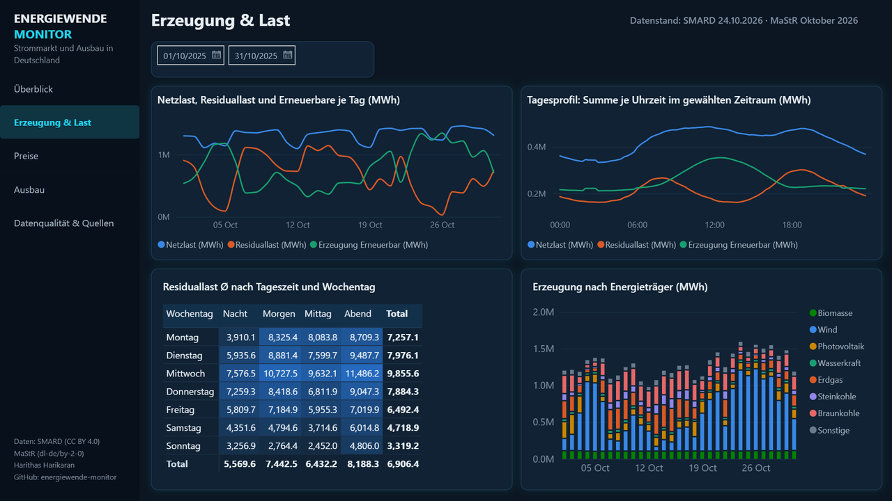
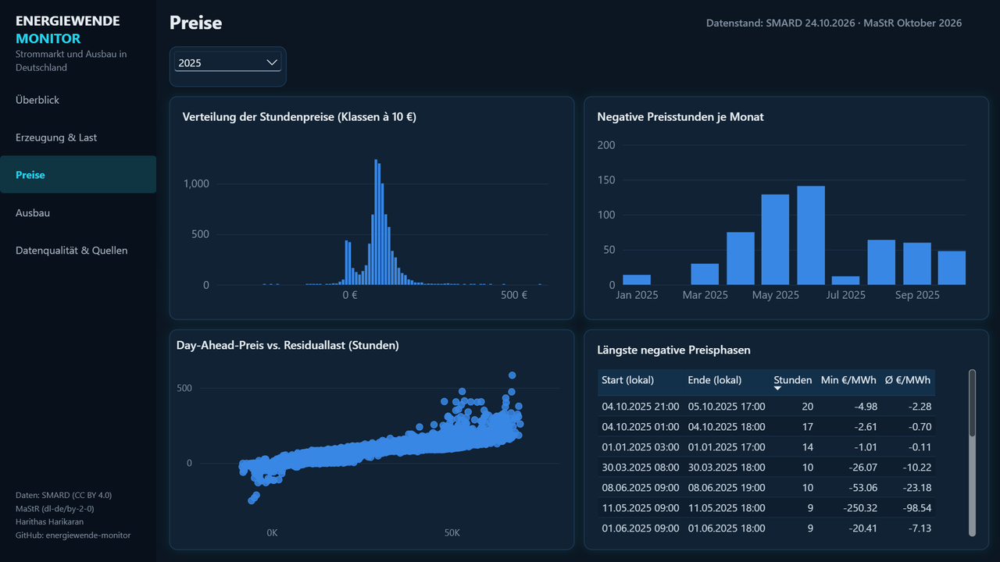
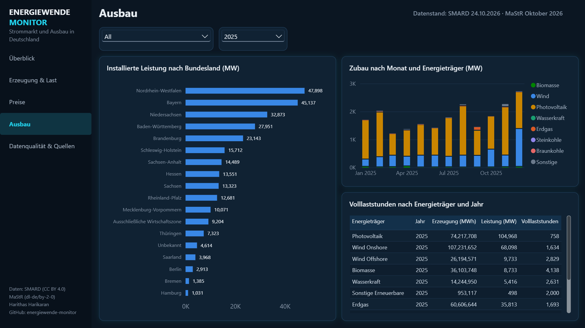
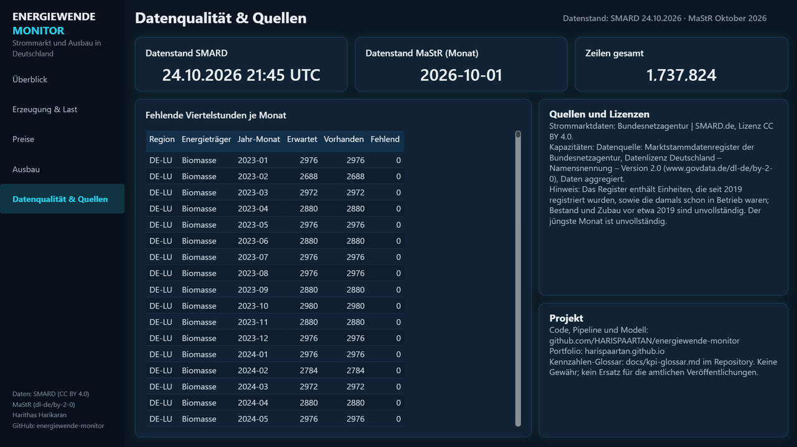
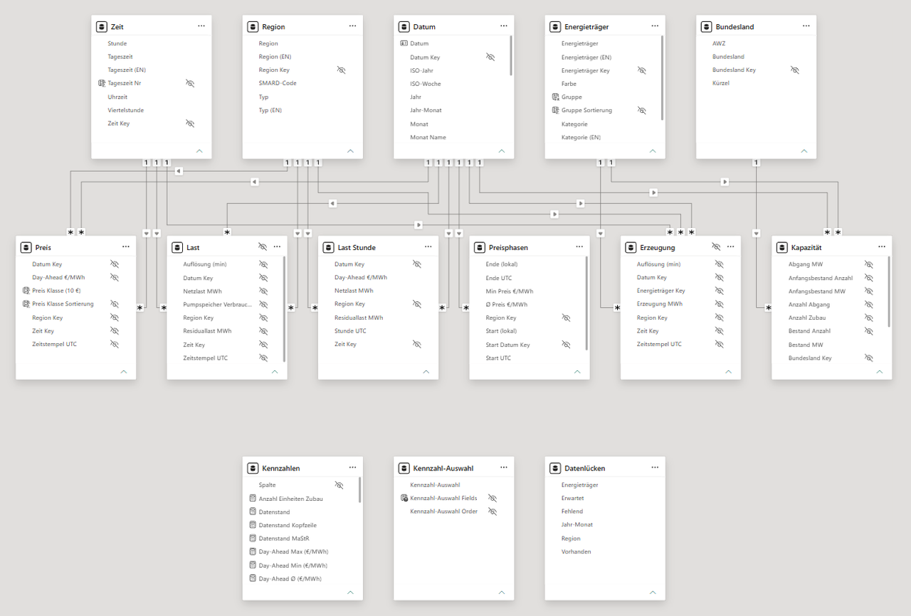
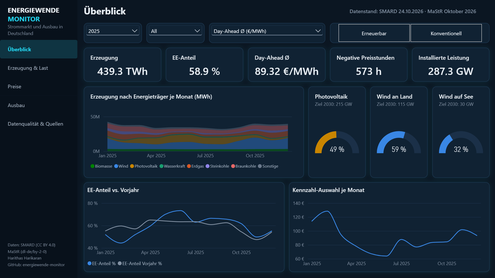

# Energiewende-Monitor

[](https://github.com/HARISPAARTAN/energiewende-monitor/actions/workflows/ci.yml)

Deutsche Strommarktdaten (SMARD) als Star-Schema in SQL Server, Basis für ein öffentliches Power-BI-Modell.
English version: [README.en.md](README.en.md).

**Stand:** Meilenstein 3 (Version 0.3.0): Datenpipeline, SQL-Schema, Tests, CI, installierte Leistung aus dem
Marktstammdatenregister sowie Power-BI-Modell und Bericht als PBIP-Projekt (Abschnitt [Bericht](#bericht)). Die erste
Validierung in Power BI Desktop und die Screenshots folgen in einer eigenen Sitzung; das Veröffentlichen ist Meilenstein 4.

Datenstand: SMARD 2026-10-25 (ab 2023-01-01, DE-LU; Ladezeit ca. 3 Minuten auf einem Laptop);
Marktstammdatenregister Exportstand 2026-10-25.

## Was der Monitor zeigt

- Stromerzeugung nach Energieträger, Netzlast, Residuallast und Pumpspeicher-Verbrauch im Marktgebiet DE-LU,
  viertelstündlich ab dem 1. Januar 2023.
- Day-Ahead-Preis DE-LU, stündlich.
- Installierte Leistung je Monat, Bundesland und Energieträger aus dem Marktstammdatenregister (Zubau, Abgang,
  Bestand). Das Monatsraster beginnt 1990, belastbar ist der Bestand erst etwa ab 2019, siehe
  [Kapazitäten (MaStR)](#kapazitäten-mastr).

## Architektur

SMARD-JSON (Wochen-Chunks, Cache in `data/raw/`) -> `stg.smard_series` -> T-SQL-Transformation ->
`dw.fact_erzeugung`, `dw.fact_last`, `dw.fact_preis` + Dimensionen `dw.dim_*` -> Views `rpt.v_*` -> Power BI.
MaStR-Seed `data/seed/kapazitaet_monat.csv` -> `stg.mastr_kapazitaet` -> `dw.fact_kapazitaet` -> `rpt.v_kapazitaet`.

Zeitstempel liegen in UTC (`ts_utc`). Die Schlüssel `datum_key` (JJJJMMTT) und `zeit_key` (0..95) sind
Europe/Berlin-Ortszeit und werden einmal in Python berechnet. Sommer- und Winterzeit werden so an einer Stelle
behandelt (92 bzw. 100 Viertelstunden am Umstellungstag).

## Schnellstart

Voraussetzungen: Docker Desktop, [uv](https://docs.astral.sh/uv/), Microsoft ODBC Driver 18 for SQL Server
(Windows: `winget install -e --id Microsoft.msodbcsql.18`).

```bash
cp .env.example .env            # MSSQL_SA_PASSWORD setzen
docker compose up -d            # SQL Server 2022 Developer, Port 1433
uv sync --dev
uv run --env-file .env ewmonitor all --fixtures   # Testwoche (Oktober 2025) laden und prüfen
uv run --env-file .env ewmonitor all              # ab 2023-01-01 bis gestern laden (ca. 3 Minuten)
```

Verbindung: `EWM_DB_SERVER` (Standard `127.0.0.1,1433`) und `EWM_DB_NAME` (Standard `energiewende`) aus der `.env`.

Befehle: `ewmonitor ingest`, `ewmonitor load`, `ewmonitor check`, `ewmonitor all`, jeweils mit `--from`, `--to`;
`ingest` und `all` zusätzlich mit `--regions` und `--refresh-days` (Standard 60: Chunks, die in den letzten 60 Tagen
enden, werden neu geladen, weil SMARD Wochen nachträglich neu veröffentlicht). `ewmonitor all --fixtures` arbeitet
ohne Netzwerk.

## Tests

- `uv run pytest tests/unit` (ohne Datenbank): Parser, Zeitzonen, Dimensionen, Client mit gemocktem HTTP,
  MaStR-Leser (SQLite und XML auf derselben synthetischen Fixture), Zuordnung und Aggregation.
- `uv run --env-file .env pytest tests/dq -m db`: Zeilen je Tag, Pivot, Stundenaggregat, Idempotenz der Ladeläufe,
  Fehler im Faktenladen. Die Suite arbeitet in einer eigenen Datenbank (`EWM_DQ_DB_NAME`, Standard `energiewende_dq`),
  leert dort Staging und Fakten und lädt die Testwoche; die Datenbank aus `EWM_DB_NAME` bleibt unberührt.
  Für die Kapazitäten: laufender Bestand nach Zubau und Abgang, lückenloses Monatsraster bis zum letzten Monat,
  AWZ- und UNB-Zeilen, die vier Kapazitätsprüfungen auf dem Fixture-Seed und die Idempotenz von
  `dw.fact_kapazitaet`.
- `uv run pytest tests/pbi -m "pbi and not live"` (offline): Schemaprüfung der TMDL- und PBIR-Dateien gegen die
  vendorten Microsoft-Schemas, Lint von Modell, Kennzahlen und Seiten, Glossar, öffentliche Variante und die Definition des
  Abgleichs. Optional: `uv run python tools/pbi/fetch_tom.py` und `uv run --group pbi pytest tests/pbi/test_tmdl_tom.py` parsen das Modell mit
  Microsofts TOM; `tests/pbi/test_reconcile.py` (Marker `live`) vergleicht neun Kennzahlen mit SQL, sobald Desktop offen ist.
- GitHub Actions führt Lint, Unit- und Power-BI-Tests und die Datenqualität gegen einen SQL-Server-Container aus (`.github/workflows/ci.yml`).

## Fehlerbehandlung

HTTP-Fehler, die vorübergehend sein können (Verbindungsabbruch, Zeitüberschreitung, 429, 5xx, ungültiges JSON),
werden mit Wartezeit wiederholt (bis zu drei Versuche). Ein Chunk, der danach noch fehlschlägt, bricht den Lauf ab: Das Staging
wird je Reihe und Zeitraum ersetzt, ein übersprungener Chunk würde gute Zeilen dieser Woche löschen. Liefert SMARD
für eine konfigurierte Reihe keinen Index (404), hat sie keine Chunks; das wird als WARNING protokolliert.
Datenbankfehler brechen den Lauf ab und rollen den Schritt zurück; `--from`/`--to` außerhalb des Kalenders
(`scope.start` bis 2030-12-31) werden abgelehnt.

## Datenqualität

`ewmonitor check` prüft: Viertelstunden je Tag für Erzeugung und Last (innerhalb der jeweils geladenen Spanne),
Nullwerte in Erzeugung und Last, keine negative Erzeugung, 23, 24 oder 25 Stundenpreise je Tag, Preise zwischen
-500 und 4000 EUR/MWh, Zuordnung aller Staging-Zeilen, Abgleich Staging gegen Fakten je Faktentabelle,
unvollständige Stunden der Last (nur Warnung; Lücken in den Quelldaten, meist jüngere, die SMARD noch nachliefern kann) und Aktualität
(Warnung ab 45 Tagen). Fehlende Viertelstunden je Monat liefert die View `rpt.v_dq_luecken`.
Für die Kapazitäten: kein negativer Bestand, Staging gegen Fakten, lückenloses Monatsraster je Bundesland und
Energieträger und ein Plausibilitätsband für den bundesweiten Bestand im neuesten Monat (nur Warnung).

Die View `rpt.v_last_stunde` fasst die Last je UTC-Stunde zusammen. Eine Messgröße hat dort nur dann einen Wert,
wenn alle vier Viertelstunden der Stunde einen Wert haben, sonst NULL; die Spalten `viertelstunden_*` nennen die
Anzahl der vorhandenen Werte.

## Kapazitäten (MaStR)

Datenquelle: Marktstammdatenregister der Bundesnetzagentur, Datenlizenz Deutschland – Namensnennung – Version 2.0
(https://www.govdata.de/dl-de/by-2-0), Daten aggregiert.

Der Seed `data/seed/kapazitaet_monat.csv` (Exportstand 2026-10-25, 25.323 Zeilen, 1,1 MB) verdichtet 9.663.557
Einheiten aus acht Einheitentabellen zu Zubau, Abgang und Anfangsbestand je Monat, Bundesland und Energieträger.
`ewmonitor load` und `ewmonitor all` laden ihn nach `stg.mastr_kapazitaet` und bauen daraus `dw.fact_kapazitaet`
mit laufendem Bestand. Die View `rpt.v_kapazitaet` hat die Spalten `datum_key`, `jahr_monat`, `bundesland_key`,
`energietraeger_key`, `zubau_mw`, `anzahl_zubau`, `abgang_mw`, `anzahl_abgang`, `anfangsbestand_mw`,
`anfangsbestand_anzahl`, `bestand_mw`, `bestand_anzahl`. `bestand_mw` ist der Wert am Monatsende, nach Zubau und
Abgang des Monats. Der neueste Monat ist angebrochen, und weil Anlagen oft erst Wochen nach der Inbetriebnahme
registriert werden, fällt der Zubau der letzten zwei bis drei Monate zu niedrig aus.

Bestand im Oktober 2026 (Nettonennleistung): Photovoltaik 116,6 GW, Wind an Land 71,5 GW, Wind auf See 11,6 GW,
Erdgas 35,8 GW, Steinkohle 15,1 GW, Braunkohle 14,8 GW, Pumpspeicher 9,9 GW, Biomasse 8,8 GW, Wasserkraft 5,3 GW,
Kernenergie 0 (seit April 2023).

Regeln (Begründung in `docs/decisions/ADR-004-mastr-seed.md`):

- Es zählen Einheiten `In Betrieb`, `Vorübergehend stillgelegt` und `Endgültig stillgelegt`; `In Planung` nicht
  (75.731 Einheiten).
- Zubau im Monat der Inbetriebnahme, Abgang im Monat der endgültigen Stilllegung. Vorübergehend stillgelegte
  Einheiten bleiben im Bestand.
- Einheiten mit Inbetriebnahme vor 1990 oder ohne Datum gehen als Anfangsbestand in den Januar 1990 ein.
- Offshore-Wind in der Ausschließlichen Wirtschaftszone erhält das Bundesland `AWZ`. Ohne Bundesland steht
  `UNB` (Unbekannt): 74 Einheiten, vor allem Wasser- und Pumpspeicherkraftwerke in Luxemburg, Österreich und an der
  Schweizer Grenze, die in das deutsche Netz einspeisen.
- Batterien und andere Speicher außer Pumpspeichern sind ausgeschlossen (2.892.406 Einheiten): SMARD weist für sie
  keine Erzeugung aus.
- Die Zuordnung zu den SMARD-Energieträgern steht in `data/seed/mastr_energietraeger_mapping.csv`, die Wertelisten
  des Exports in `docs/mastr-profil.md`. Im Export 2026-10-25 bleibt kein Wert ohne Zuordnung.
- Photovoltaik: Die Nettonennleistung (Wechselrichter) liegt rund 11 % unter der Bruttoleistung der Module, die
  die Bundesnetzagentur in ihren Zubauzahlen meldet (Oktober 2026: 116,6 statt 131,7 GW).
- **Historie vor 2019 ist unvollständig.** Das Register enthält nur Einheiten, die seit seinem Start 2019
  registriert wurden, sowie die damals schon in Betrieb waren; früher stillgelegte oder gelöschte Anlagen fehlen.
  Bestand und Zubau vor etwa 2019 zeigen daher den heute registrierten Anlagenpark nach Inbetriebnahmedatum,
  nicht den damaligen Bestand. Beispiele: Kernenergie steht von 1990 bis Ende 2021 konstant bei 8,1 GW
  (2010 waren rund 20,5 GW am Netz); Wind an Land hat Ende 2010 24,0 GW statt rund 27 GW.
- Notstromaggregate und Netzreserve bleiben in Meilenstein 2 im Bestand: 3,0 GW Mineralölprodukte und 0,6 GW
  Erdgas tragen `Notstromaggregat = 1`, 7,45 GW Steinkohle `NetzreserveZugeordnet = 1`. Meilenstein 3 lässt sie im
  Bestand; sie blähen die Kapazitätsbasis auf und drücken die Volllaststunden dieser Energieträger (siehe
  [docs/kpi-glossar.md](docs/kpi-glossar.md)).

Seed neu erzeugen (nur auf dem Entwicklerrechner, nicht in CI):

```bash
uv sync --extra mastr
uv run ewmonitor seed-mastr --profile                   # Download mit open-mastr, dann Seed und Profil
uv run ewmonitor seed-mastr --skip-download --profile   # vorhandenen Zip verwenden (ca. 5 Minuten)
```

`--source xml` (Standard) liest den Gesamtdatenexport-Zip direkt: lxml streamt die UTF-16-XML-Dateien bei
konstantem Speicher und löst die Katalogwerte selbst auf. open-mastr 1.0 dient nur als Downloader, weil sein
SQLite-Import an allen 66 Solar-Dateien des Exports 2026-10-25 scheitert (Mehrfachwerte wie `710 3183` in einer
Ganzzahlspalte). `--source sqlite` liest die open-mastr-Datenbank; für den Export 2026-10-25 fehlen dort
`EinheitenSolar` und `EinheitenVerbrennung` ganz, der SQLite-Leser dient also Tests und Vergleichen, nicht als
Ersatz für den echten Seed. Der Exportstand im Seed kommt aus dem Dateinamen des Zips; ein abweichendes
`--date YYYYMMDD` gewinnt mit einer Warnung. `seed-mastr --fixtures --profile` schreibt
`docs/mastr-profil-fixture.md` und lässt das echte Profil unberührt. Platz: Zip 2,4 GB, SQLite-Datenbank von open-mastr 3,7 GB
(entsteht beim Download mit); Budget 15 GB. Laufzeit am 2026-10-25: Download 12 Minuten, open-mastr-Import
16 Minuten, XML-Leser 5 Minuten.

Hinweis: `ewmonitor all --fixtures` ersetzt die Kapazitätsdaten der Entwicklerdatenbank (`EWM_DB_NAME`) durch den
Fixture-Seed. Vor einer Power-BI-Aktualisierung deshalb `ewmonitor load` erneut ausführen.

## Bericht

Das Power-BI-Projekt liegt als PBIP im Repository: `powerbi/EnergiewendeMonitor.pbip` mit dem Semantikmodell als TMDL
(`EnergiewendeMonitor.SemanticModel/`) und dem Bericht im PBIR-Format (`EnergiewendeMonitor.Report/`). Beide werden
code-first erzeugt und geprüft (`tools/pbi/`, `tests/pbi/`); Desktop liest die Dateien direkt. Das Modell hat 14 Tabellen
(vier Fakten, `Last Stunde`, `Preisphasen`, `Datenlücken`, fünf Dimensionen, `Kennzahlen`, `Kennzahl-Auswahl`),
26 Kennzahlen mit englischer Beschreibung, eine Rolle (`Landesbehörde BW`, Zeilensicherheit auf `Bundesland[Kürzel] = "BW"`) und das
Thema `Energiewende`. Jede Kennzahl ist in [docs/kpi-glossar.md](docs/kpi-glossar.md) mit Formel, Einheit, Quelle und
Hinweisen beschrieben.

Die fünf Seiten (16:9, 1280 mal 720, deutsche Beschriftung):

1. **Überblick**: Filter für Jahr, Monat, Kennzahl-Auswahl und Kategorie; fünf Kennzahlenkarten (Erzeugung, EE-Anteil, Day-Ahead Ø,
   negative Preisstunden, installierte Leistung), Erzeugung je Monat nach Energieträger, EE-Anteil gegen das Vorjahr und ein Liniendiagramm,
   das der Feldparameter `Kennzahl-Auswahl` umschaltet. Zwei Lesezeichen, `Erneuerbar` und `Konventionell`, filtern die Kategorie; weil
   Lesezeichen in einem veröffentlichten Bericht nicht erreichbar sind, gibt es denselben Filter zusätzlich als Slicer
   `Kategorie`. Ein Rechtsklick auf einen Monat springt per Drillthrough zu Erzeugung & Last.
2. **Erzeugung & Last**: Netzlast, Residuallast und erneuerbare Erzeugung je Tag, das Tagesprofil nach Uhrzeit, eine Heatmap der
   mittleren Residuallast nach Tageszeit und Wochentag und die Erzeugung nach Energieträger; Zielseite des Drillthroughs.
3. **Preise**: Histogramm der Stundenpreise in Klassen zu 10 EUR/MWh, negative Preisstunden je Monat, Day-Ahead-Preis gegen Residuallast
   je Stunde und die zehn längsten negativen Preisphasen (die Tabelle hat einen TopN-10-Filter).
4. **Ausbau**: installierte Leistung nach Bundesland, Zubau nach Monat und Energieträger, Volllaststunden nach Energieträger und Jahr
   (Aussagekraft und Grenzen: Abschnitt [Kapazitäten (MaStR)](#kapazitäten-mastr) und das Glossar).
5. **Datenqualität & Quellen**: Datenstand SMARD und MaStR, Zeilenzahl, fehlende Viertelstunden je Monat, Quellen und Lizenzen.







Modellansicht und der Feldparameter-Slicer in Aktion:




(Die Bilder entstehen in der Validierungssitzung mit Power BI Desktop, Liste: [docs/screenshots/SHOTLIST.md](docs/screenshots/SHOTLIST.md), Ablauf: [docs/owner-validierung.md](docs/owner-validierung.md).)

**Projekt öffnen.** Power BI Desktop mit den Vorschaufunktionen `Power BI Project (.pbip) save option` und
`Store semantic model using TMDL format` (Datei, Optionen, Vorschaufeatures), dann `powerbi/EnergiewendeMonitor.pbip` öffnen. Der Bericht öffnet
ohne Daten, weil kein Cache im Repository liegt (`.pbi/cache.abf` ist git-ignoriert). Die lokale Datenbank muss laufen
(`docker compose up -d`, danach `uv run --env-file .env ewmonitor load`), dann Start, Aktualisieren.

**SQL-Zugangsdaten.** Die Quelle ist `Sql.Database("127.0.0.1,1433", "energiewende")` auf den Ansichten des Schemas `rpt`. Beim
ersten Aktualisieren fragt Desktop nach den Zugangsdaten: Reiter Datenbank, Benutzer `sa`, das Kennwort aus der `.env`
(von Hand eingeben), Ebene `127.0.0.1,1433`. Das Kennwort steht in keiner Projektdatei. Fragt Desktop nach der Verschlüsselung,
mit OK bestätigen.

**Öffentliche Variante.** `uv run python tools/pbi/make_public_variant.py` kopiert das Projekt nach `build/public/` als
`EnergiewendeMonitor (öffentlich)` und entfernt die Rolle. Tabellen, Beziehungen, Kennzahlen und Seiten bleiben byte-gleich. Diese
Kopie ist die, die per "Im Web veröffentlichen" freigegeben wird (ADR-002, kein RLS); das Hauptprojekt behält die Rolle.

**Abgleich Modell und Warehouse.** Neun Kennzahlen (Erzeugung, EE-Anteil, negative Preisstunden, Day-Ahead Ø, installierte Leistung
zweimal, Zubau, Volllaststunden, Zeilen) werden gegen SQL geprüft:

```bash
uv run --env-file .env python -m tools.pbi.reconcile sql           # die neun SQL-Werte (sql/queries/reconcile_m3.sql)
uv run python -m tools.pbi.reconcile dax-queries                   # die neun DAX-Abfragen
uv run python tools/pbi/fetch_adomd.py                             # einmalig: ADOMD-Client nach build/adomd/ (alternativ DAX Studio)
uv run --env-file .env --group pbi pytest tests/pbi/test_reconcile.py -m live -q   # mit geöffnetem Desktop
```

Der letzte Befehl braucht ein geöffnetes Desktop mit dem Projekt und überspringt sich sonst mit Begründung. Ohne ADOMD:
die neun DAX-Abfragen in der DAX-Abfrageansicht von Desktop ausführen und mit der SQL-Ausgabe von Hand vergleichen; die Ergebnisse stehen
im Glossar unter [Abgleich](docs/kpi-glossar.md#abgleich-mit-dem-data-warehouse).

## Entwicklung

`uv sync --dev` installiert die Entwicklungswerkzeuge, lässt aber die optionale Abhängigkeit `open-mastr` weg (und entfernt sie, wenn
sie schon installiert war). Wer den Seed neu erzeugt, nutzt `uv sync --dev --extra mastr`. Für die optionalen Power-BI-Prüfungen
(TMDL-Parser, ADOMD-Abgleich) kommt `--group pbi` hinzu (pythonnet).

Quelle der Wahrheit für den Bericht: Vor der Validierungssitzung mit Power BI Desktop erzeugen `tools/pbi/pages.json` und
`tools/pbi/build_report.py` die Berichtsdateien (`uv run python tools/pbi/build_report.py`; danach darf `git status --short powerbi` nichts
ausgeben, das ist ein dokumentierter Befehl, kein Test). Nach der Sitzung sind die PBIR-Dateien, die Desktop gespeichert hat, die Quelle;
`build_report.py` wird dann nicht mehr ausgeführt, und die Lint-Tests laufen weiter auf den gespeicherten Dateien
(siehe [docs/owner-validierung.md](docs/owner-validierung.md)).

Qualitätstore: `uv run ruff check .`, `uv run pytest tests/unit tests/pbi -m "not live" -q`,
`uv run --env-file .env pytest tests/dq -m db -q`, `uv lock --check`. CI führt Lint, Unit- und Power-BI-Tests
(`pytest tests/pbi -m "pbi and not live"`, offline auf den committeten Dateien) und die Datenqualitätsprüfung gegen SQL Server aus.

## Datenquellen und Lizenzen

- SMARD, Bundesnetzagentur: Lizenz CC BY 4.0, Quellenangabe `Bundesnetzagentur | SMARD.de`.
  Filter: Erzeugung 1223, 1224, 1225, 1226, 1227, 1228, 4066, 4067, 4068, 4069, 4070, 4071; Verbrauch 410, 4359, 4387;
  Preis 4169. Kernenergie (1224): letzte Erzeugung in der Viertelstunde ab 2023-04-15 23:45 Ortszeit, danach
  Nullwerte bis 2024-01-30 12:15, ab 2024-01-30 12:30 keine Werte mehr (NULL); die Reihe endet in den Quelldaten
  am 2024-02-04.
- Marktstammdatenregister, Bundesnetzagentur: Datenlizenz Deutschland – Namensnennung – Version 2.0, Quellenangabe
  siehe [Kapazitäten (MaStR)](#kapazitäten-mastr). Im Repository liegen nur aggregierte Werte.

## Entscheidungen

Siehe `docs/decisions/` (SQL Server, Publish to web, Umfang, MaStR-Seed) und `docs/CHANGELOG.md`.

## Grenzen

Erzeugung, Last und Preise nur für das Marktgebiet DE-LU; die Regelzonen folgen in Meilenstein 5. Keine
Prognosen, keine Redispatch-Daten. Der MaStR-Export und die Rohdaten im Cache sind nicht Teil des Repositories.

## Lizenz

Code: MIT. Daten: siehe Datenquellen. Die Vorlagen für die Berichtselemente stammen aus microsoft/fabric-toolbox (MIT),
siehe `tools/pbi/templates/README.md` und `tools/pbi/templates/LICENSE-fabric-toolbox.txt`.
